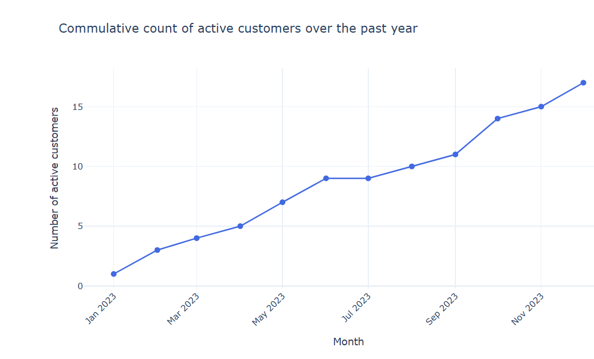

# Telecom Customer Churn and Usage Analysis

An analysis of telecom customer behavior, focused on churn, subscription plans, and usage patterns. The Jupyter notebook cleans and combines customer, subscription, and monthly usage data; compares active and churned customers; calculates data consumption by plan; visualizes active-user growth; and generates entity-relationship diagrams (ERDs) for the data model.

## Project contents

- `DataAnalysisofTelecomData.ipynb` — exploratory analysis, cleaning, visualizations, SQL example, and ERD generation.
- `data/` — input datasets (`Customers.csv`, `Subscriptions.csv`, and `Usage.csv`).
- `results.png` — active-customer growth chart from the analysis.
- `requirements.txt` — Python packages needed to run the notebook.

The notebook reads the three CSV files from the `data/` directory.

## Results

The notebook's current results identify **14 active customers** and **6 churned customers**. Average monthly data usage by plan is:

| Plan | Average data usage (GB) |
| --- | ---: |
| Bronze Plan | 5.7575 |
| Gold Plan | 5.7883 |
| Platinum Plan | 5.5725 |
| Silver Plan | 4.8265 |

The chart below shows the cumulative active-customer count over the year.



## Getting started

Create and activate a virtual environment from the project directory:

```bash
python3 -m venv .venv
source .venv/bin/activate
```

On Windows PowerShell, activate it with:

```powershell
.venv\Scripts\Activate.ps1
```

Install the Python dependencies and launch the notebook:

```bash
python -m pip install --upgrade pip
python -m pip install -r requirements.txt
jupyter notebook DataAnalysisofTelecomData.ipynb
```

The notebook renders ERD images using Graphviz. The Python `graphviz` package is listed in `requirements.txt`; the Graphviz system executable must also be installed and available on your `PATH` (for example, `sudo apt install graphviz` on Debian/Ubuntu).

## Analysis workflow

1. Load and inspect the customer, subscription, and usage datasets.
2. Clean date fields, remove the empty subscription row, and normalize a misspelled plan name.
3. Count active and churned customers using both status and churn date.
4. Merge the three datasets and compare average monthly data usage by plan.
5. Plot active-user growth and generate ERDs for the source tables.
6. Provide a SQL example for total minutes used per customer.

The figures and summary above reflect the results currently captured in the project.
